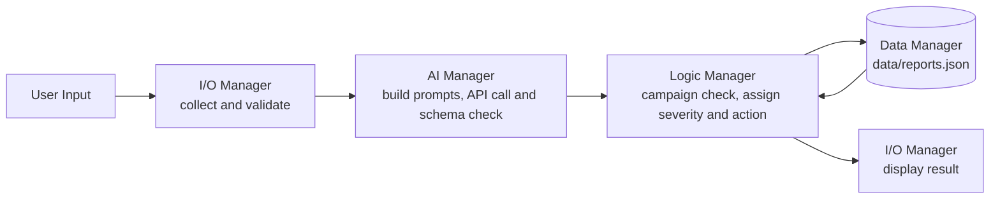

# Phishing / Suspicious Email Triage Assistant

INF1103 Team Project, Group P5-6

Small IT teams without a dedicated SOC (Security Operations Center) face a major bottleneck. General staff constantly report suspicious emails, but with limited manpower, often just a handful of staff supporting an entire organization, there’s no quick way to determine if each report is genuine phishing or just spam. Every reported email must be read and judged one at a time by a small IT team.

This command-line assistant uses an AI model to assess each reported email, applies fixed business rules to decide its severity, and recommends an action, so the IT team can deal with the most dangerous reports first.

**Target users**: Small IT teams without a dedicated SOC (e.g. a team of 3-5 IT staff supporting 80-100+ employees) that need help prioritizing which reports to act first. 

The full problem statement, including the internship experience that motivated
the project, is in [ProjectInitialDetails.md](ProjectInitialDetails.md).

## Table of Contents

- [Features](#features)
- [Usage](#usage)
- [Architecture](#architecture)
- [Program Flow](#program-flow)
- [Setup](#setup)


## Features

- Email report collection and validation
  - Prompts the user to enter key email details such as sender, subject, body text, URLs, and attachments
  - Validates the input to reduce errors before analysis
  - Supports multi-line email bodies and optional attachment or URL collection

- AI-powered phishing classification
  - Sends the reported email to an external AI model through OpenRouter
  - Builds a structured prompt using YAML configuration file
  - Validates the AI response by checking if it matches the expected schema
  - Returns safe fallback result if the AI cannot assess the email

- Threat assessment and prioritisation
  - Evaluates the AI's classification, threat level, suspicious URLs, suspicious attachments, and sender-domain mismatch
  - Determines whether the report is low risk, needs review, or is critical

- Campaign detection
  - Identifies whether multiple suspicious reports are connected by sender or domain within 24-hour window
  - Treats repeated reports from the same sender or domain as a possible coordinated attack

- Severity-based triage
  - Classifies each report as:
    - LOG_ONLY
    - NEEDS_REVIEW
    - CRITICAL
  - Escalates severity when multiple suspicious indicators are present

- Recommended response actions
  - Produces action guidance for each severity level, such as blocking a domain, escalating for manual review, or archiving the report
  - Helps IT staff quickly decide the next step and what to prioritize

- Persistent reporting history
  - Saves all processed reports to a local JSON history file
  - Allows previously submitted emails to be reviewed later
  - Supports filtering by severity and sorting by threat level

- Report review menu
  - Lets users:
    - Screen a new suspicious email,
    - View saved reports grouped by severity
    - Review the most urgent cases first

## Usage

When program starts, choose from the menu shown:

1. **Screen a new email.** <br>Enter the sender's email address and display
   name, the subject, the body (type `END` on its own line to finish), and any
   URLs or attachment filenames. The assistant classifies the email, decides its
   severity, shows a recommended action and saves the report.
2. **View saved reports by severity.** <br>Choose CRITICAL, NEEDS_REVIEW or LOG_ONLY
   to list those reports, highest threat level first.
3. **Exit.**

<details><summary>Example: screening an email</summary>

```Bash
=== Report a suspicious email ===
Sender email: john.tan@yourcompany-support.com
Sender display name (optional, press Enter to skip): John Tan (CEO)
Subject: Quick favor - urgent wire transfer
Body text (paste the email, then type END on its own line to finish):
Hi Sarah,
I'm stuck in a meeting and can't call. Can you process an urgent transfer of $8,500 to our new vendor today? I'll send the account details shortly. Please keep this between us for now, it's time sensitive.
Thanks, John
END
Any URLs found in the email? (y/n): n
Any attachments? (y/n): n

===========================================================================================
SCREENING RESULT
===========================================================================================
Sender:                 John Tan (CEO) <john.tan@yourcompany-support.com>
Subject:                Quick favor - urgent wire transfer
Reported at:            2026-10-13T09:41:17+00:00
-------------------------------------------------------------------------------------------
Classification:         spear-phishing
Tactics detected:       impersonation, urgency_pressure, secrecy_request, financial_request
Threat level:           90
Suspicious urls:        none
Suspicious attachments: none
Sender domain mismatch: YES
-------------------------------------------------------------------------------------------
Campaign:               no
Severity:               CRITICAL
Recommended action:     Block sender domain and alert all users.
===========================================================================================
```

</details>
<details><summary>Example: viewing saved reports</summary>

```bash
=== Phishing Triage Assistant ===
  1. Screen a new email
  2. View saved reports by severity
  3. Exit
Choose an option: 2

=== View saved reports ===
  1. CRITICAL
  2. NEEDS_REVIEW
  3. LOG_ONLY
Choose an option: 1

================================================================
 CRITICAL REPORTS  (3 saved, highest threat first)
================================================================

 [1]  13 Oct 2026, 17:41 SGT
----------------------------------------------------------------
   From:           John Tan (CEO) <john.tan@yourcompany-support.com>
   Subject:        Quick favor - urgent wire transfer
   Classification: spear-phishing
   Threat level:   90 / 100
   Campaign:       no
   Action:         Block sender domain and alert all users.

 [2]  13 Oct 2026, 18:03 SGT
----------------------------------------------------------------
   From:           Accounts Payable <billing@acc0unts-payable.net>
   Subject:        Overdue invoice #INV-20931 - final notice
   Classification: phishing
   Threat level:   85 / 100
   Campaign:       no
   Action:         Block sender domain and alert all users.

 [3]  13 Oct 2026, 17:57 SGT
----------------------------------------------------------------
   From:           IT Helpdesk <it-helpdesk@yourcompany-mail.org>
   Subject:        Mailbox storage almost full
   Classification: phishing
   Threat level:   80 / 100
   Campaign:       no
   Action:         Block sender domain and alert all users.

================================================================
```
</details>

## Architecture

The program is fully procedural (no class definitions) and is split to 4 managers. `main.py` runs the menu and passes the menu between them. Each manager has one job


| Manager | File | Responsibility |
|---|---|---|
| I/O | `src/io/io_manager.py` | Menus, input validation and re-prompting, formatting and printing every message, record and list |
| AI | `src/ai/ai_manager.py` | Builds the prompts from `prompt_config.yaml`, calls OpenRouter, parses and validates the JSON response. No domain rules|
| Logic | `src/logic/logic_manager.py` | Campaign detection, severity rules and the recommended action |
| Data | `src/data/data_manager.py` | Loads and saves ai response to `data/reports.json`

## Program Flow

**How one email moves through the program**

1. **I/O**: collects the email fields and validates each one (re-prompts for invalid inputs), then adds a UTC `reported_at` timestamp
2. **AI**: receives only the email content (no timestamp), sends it with the built system prompt, and returns a validated dict: `classification`, `threat_level`, `tactics_detected`, `suspicious_urls`, `suspicious_attachment`, `sender_domain_mismatch`. If the AI cannot give a valid answer it returns `AI_UNAVAILABLE` placeholder instead
3. **Data**: loads the saved report history
4. **Logic**: checks the history for a campaign, decides the severity and picks the recommended action
5. **Data**: combines the email, AI ouput and decision into one flat record and saves the full history
6. **I/O**: displays the result of the screening

## Setup

### Prerequisites

- Git 
- Docker Desktop or Docker Engine
- A personal OpenRouter API key (Create one at https://openrouter.ai/keys)

### 1. Clone and Configure

```bash
git clone https://github.com/HoiShaoMeng/26INF1103P5-6.git
cd 26INF1103P5-6
cp .env.example .env
```
Open `.env` and add your key, with no spaces around `=` and no quotes:
```
OPENROUTER_API_KEY=sk-or-v1-yourkeyhere
```
On Windows, save `.env` as UTF-8 (not "with BOM") with LF line endings, or Docker
won't read the key.

### 2. Build

```bash
docker build -t phishing-triage .
```

### 3. Run

```bash
docker run -it --rm --env-file .env -v ./data:/app/data phishing-triage
```
- `-it` lets you type into the program
- `-v ./data:/app/data` saves reports to `data/` on your machine, so history is kept
  between runs

On Windows PowerShell, use `-v ${PWD}/data:/app/data` if `./data` gives an error.