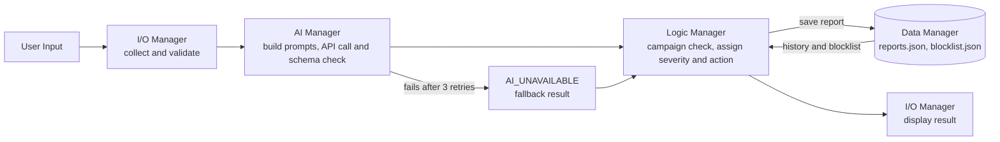

# Phishing / Suspicious Email Triage Assistant

INF1103 Team Project, Group P5-6

Small IT teams without a dedicated SOC (Security Operations Center) face a major bottleneck. General staff constantly report suspicious emails, but with limited manpower, often just a handful of staff supporting an entire organization, there’s no quick way to determine if each report is genuine phishing or just spam. Every reported email must be read and judged one at a time by a small IT team.

This command-line assistant uses an AI model to assess each reported email, applies fixed business rules to decide its severity, and recommends an action, so the IT team can deal with the most dangerous reports first. In Part 2 it also lets an analyst correct the AI, remembers confirmed attackers, and shows a dashboard of everything reported.

**Target users**: Small IT teams without a dedicated SOC (e.g. a team of 3-5 IT staff supporting 80-100+ employees) that need help prioritizing which reports to act first.

The full problem statement, including the internship experience that motivated
the project, is in [ProjectInitialDetails.md](ProjectInitialDetails.md).

| | Part 1 | Part 2 |
|---|---|---|
| Design | Procedural functions in four manager files | Object-oriented: ~60 classes, abstract base classes, inheritance, composition and polymorphism, four managers kept |
| Severity rules | One classify_severity() function with a chain of if statements | One SeverityRule subclass per rule, run in order by SeverityClassifier |
| New feature | – | Analyst review and blocklist: confirm or reject a report, block confirmed attackers, re-check reports the AI missed |
| Extra feature | – | Dashboard: severity breakdown, 7-day trend, active campaigns, top tactics, AI availability |
| Tests | 21 tests, logic manager only | Over 300 tests across every layer, all without a live AI |
| CI | Lint, tests, tests inside Docker, commit-message check | Same checks, now also reused as the first gate of every release |
| Continuous Deployment | Tag → build, test in Docker, push to GHCR, create a release | Gated release: full CI first, then tests on the exact image, a smoke test of the app, version tags and generated notes. Nothing is published if any gate fails | 

## Table of Contents

- [Features](#features)
- [Usage](#usage)
- [Architecture](#architecture)
- [Program Flow](#program-flow)
- [Severity Rules](#severity-rules)
- [Data Storage](#data-storage)
- [Setup](#setup)
- [Running the Tests](#running-the-tests)
- [CI/CD](#cicd)


## Features

- Email report collection and validation
  - Prompts the user to enter key email details such as sender, subject, body text, URLs, and attachments
  - Validates the input to reduce errors before analysis
  - Supports multi-line email bodies and optional attachment or URL collection

- AI-powered phishing classification
  - Sends the reported email to an external AI model through OpenRouter
  - Builds a structured prompt using YAML configuration file
  - Validates the AI response by checking if it matches the expected schema
  - Returns safe fallback result if the AI cannot assess the email

- Threat assessment and prioritization
  - Evaluates the AI's classification, threat level, suspicious URLs, suspicious attachments, and sender-domain mismatch
  - Determines whether the report is low risk, needs review, or is critical

- Campaign detection
  - Identifies whether multiple suspicious reports are connected by sender or domain within 24-hour window
  - Treats repeated reports from the same sender or domain as a possible coordinated attack

- Severity-based triage
  - Classifies each report as:
    - LOG_ONLY
    - NEEDS_REVIEW
    - CRITICAL
  - Escalates severity when multiple suspicious indicators are present

- Recommended response actions
  - Produces action guidance for each severity level, such as blocking a domain, escalating for manual review, or archiving the report
  - Helps IT staff quickly decide the next step and what to prioritize

- Fail-safes against missed phishing
  - Reports are never auto archived if the AI is unavailable
  - Reports where the AI flagged a link or attachment as suspicious always go to a person, even with a low threat level

- Analyst review
  - An analyst confirms a saved report as phishing or safe
    - Confirmed phishing: The report becomes `CRITICAL`, the sender's domain is blocked
    - Confirmed safe: The report becomes `LOG_ONLY` and nothing is blocked
  - Earlier archived reports from the same attacker are sent back to `NEEDS_REVIEW` for a re-check
  - Every review is kept as an audit record (who, why, when, old and new severity), and the original AI result is never edited

- Blocklist
  - Any future email from a blocked sender is `CRITICAL` straight away, even if the AI is fooled or down

- Dashboard
  - Severity breakdown
  - Reports per day for the last 7 days
  - Active campaigns
  - The most common tactics
  - How often the AI answered or failed

- Persistent reporting history
  - Saves all processed reports to a local JSON history file
  - Allows previously submitted emails to be reviewed later
  - Supports filtering by severity and sorting by threat level

## Usage

When program starts, choose from the menu shown:
```
=== Phishing Triage Assistant ===
  1. Screen a new email
  2. View saved reports by severity
  3. Review a saved report
  4. View Dashboard
  5. Exit
```
1. **Screen a new email.** <br>Enter the sender's email address and display
   name, the subject, the body (type `END` on its own line to finish), and any
   URLs or attachment filenames. The assistant classifies the email, decides its
   severity, shows a recommended action and saves the report.
2. **View saved reports by severity.** <br>Choose CRITICAL, NEEDS_REVIEW or LOG_ONLY
   to list those reports, highest threat level first.
3. **Review a saved report.** Pick a report from a severity list, then confirm it as phishing or as safe, with your name and a reason.
4. **View Dashboard.** A summary of every saved report.
5. **Exit.** Ctrl+C also exits cleanly at any point.

<details><summary>Example: screening an email</summary>

```Bash
=== Report a suspicious email ===
Sender email: john.tan@yourcompany-support.com
Sender display name (optional, press Enter to skip): John Tan (CEO)
Subject: Quick favor - urgent wire transfer
Body text (paste the email, then type END on its own line to finish):
Hi Sarah,
I'm stuck in a meeting and can't call. Can you process an urgent transfer of $8,500 to our new vendor today? I'll send the account details shortly. Please keep this between us for now, it's time sensitive.
Thanks, John
END
Any URLs found in the email? (y/n): n
Any attachments? (y/n): n
Analysing email with AI...

===========================================================================================
SCREENING RESULT
===========================================================================================
Sender:                 John Tan (CEO) <john.tan@yourcompany-support.com>
Subject:                Quick favor - urgent wire transfer
Reported at:            2026-10-13T09:41:17+00:00
-------------------------------------------------------------------------------------------
Classification:         spear-phishing
Threat level:           90
Tactics detected:       impersonation, urgency_pressure, secrecy_request, financial_request
Suspicious urls:        none
Suspicious attachments: none
Sender domain mismatch: YES
-------------------------------------------------------------------------------------------
Campaign:               no
Severity:               CRITICAL
Recommended action:     Block sender domain and alert all users.
===========================================================================================
```

</details>

<details><summary>Example: viewing saved reports</summary>

```bash
=== View saved reports ===
  1. CRITICAL
  2. NEEDS_REVIEW
  3. LOG_ONLY
Choose an option: 1

================================================================
 CRITICAL REPORTS  (3 saved, highest threat first)
================================================================

 [1]  13 Oct 2026, 17:41 SGT   id 3f9a1c2e
----------------------------------------------------------------
   From:           John Tan (CEO) <john.tan@yourcompany-support.com>
   Subject:        Quick favor - urgent wire transfer
   Classification: spear-phishing
   Threat level:   90 / 100
   Campaign:       no
   Action:         Block sender domain and alert all users.

 [2]  13 Oct 2026, 18:03 SGT   id 8b41d7a0
----------------------------------------------------------------
   From:           Accounts Payable <billing@acc0unts-payable.net>
   Subject:        Overdue invoice #INV-20931 - final notice
   Classification: phishing
   Threat level:   85 / 100
   Campaign:       no
   Action:         Block sender domain and alert all users.

 [3]  13 Oct 2026, 17:57 SGT   id c52e9f13
----------------------------------------------------------------
   From:           IT Helpdesk <it-helpdesk@yourcompany-mail.org>
   Subject:        Mailbox storage almost full
   Classification: phishing
   Threat level:   80 / 100
   Campaign:       no
   Action:         Block sender domain and alert all users.

================================================================
```
</details>

<details><summary>Example: reviewing a report the AI missed</summary>

```
Choose an option: 3
=== View saved reports ===
  1. CRITICAL
  2. NEEDS_REVIEW
  3. LOG_ONLY
Choose an option: 3
 ...
 [2]  15 Nov 2026, 20:31 SGT   id fe11144a
----------------------------------------------------------------
   From:           Mary Lim (CFO) <cfo@yourcompany-mail.org>
   Subject:        Quick favour before you leave
   Classification: spam
   Threat level:   35 / 100
 ...
Report number to review (1-8): 2

=== Analyst decision ===
  1. Confirmed phishing (block sender)
  2. Confirmed safe (false alarm)
  3. Cancel
Choose an option: 1
Analyst name: Bob
Reason: CFO never asks for gift cards

================================================================
 REVIEW SAVED
================================================================
 Report:        fe11144a
 Decision:      confirmed phishing
 Severity:      LOG_ONLY -> CRITICAL
 Reviewed by:   Bob
 Reason:        CFO never asks for gift cards
 Blocked:       yourcompany-mail.org (future emails are CRITICAL)
 Re-check:      1 related LOG_ONLY report(s) moved to NEEDS_REVIEW
================================================================
```
</details>

<details><summary>Example: dashboard</summary>

```
================================================================
 DASHBOARD
================================================================

 Severity breakdown
----------------------------------------------------------------
   Critical:              7 (32%)
   Needs review:          7 (32%)
   Log only:              8 (36%)
   Total:                 22

 Last 7 days
----------------------------------------------------------------
   2026-11-11:            2
   ...
   2026-11-17:            7
   Total:                 22

 Active campaigns
----------------------------------------------------------------
   Campaign 1:            parcel-track.info: 3 reports, latest 17 Nov 2026, 14:31 SGT

 Top tactics
----------------------------------------------------------------
   Urgency pressure:      7 of 22 reports
   Impersonation:         4 of 22 reports
   Financial request:     3 of 22 reports

 AI availability
----------------------------------------------------------------
   Model:                 baidu/ernie-5.5-flash-preview:free
   Answered:              20 of 22 (91%)
   Unavailable:           2 of 22 (9%)
   Last failure:          13 Nov 2026, 22:31 SGT
================================================================
```
</details>

## Architecture

The four Part 1 manager responsibilities are kept, each in its own layer under src/, with a domain layer for the objects they pass between them. main.py is the composition root: it builds every object once and passes it in, so no class creates the services it depends on.

| Layer | Manager (entry point) | Responsibility | Key classes |
|---|---|---|---|
| I/O | IOManager (src/io/io_manager.py) | Menus, input validation and re-prompting, displaying results, lists, the dashboard and errors. No business logic. | MenuPrompt, EmailPrompt, InputValidator, ReviewPrompt, TextView (ABC) → ResultView, ReportListView, DashboardView; ErrorView, LoadingIndicator |
| AI | AIManager (src/ai/ai_manager.py) | Builds the prompts, calls the AI through a client, parses the reply and validates the schema. No domain rules. | AIClient (ABC) → OpenRouterClient; PromptConfig, PromptBuilder, ResponseValidator, ValidationRule (ABC) → 6 rule classes; AIError → AIConnectionError, MalformedResponseError, SchemaValidationError |
| Logic | src/logic/logic_manager.py | Campaign detection, severity rules, recommended actions, analyst reviews and the dashboard. | CampaignDetector, SeverityClassifier, ActionRecommender, SeverityRule (ABC) → 6 rule classes; ReviewService, Dashboard, DashboardPanel (ABC) → 5 panel classes |
| Data | DataManager (src/data/data_manager.py) | Loads and saves reports and the blocklist, filters and sorts the history, handles missing or corrupt files. Never prints. | JsonReportRepository, JsonBlocklistStore, JsonListFile, ReportHistory, ReportStorageError |
| Domain | – | The objects passed between layers. | ScreeningReport, TriageDecision, Attachment, AnalystReview, Blocklist |

Two services at the root coordinate the managers: App runs the menu, and TriageService runs one screening (AI with retries → campaign check → severity → action → save).

## Program Flow

**Screening one email (menu option 1)**



1. **Data**: the latest history and blocklist are loaded first, so a corrupt file is reported before the user types anything
2. **I/O**: collects and validates the email fields and adds a UTC `reported_at` timestamp
3. **AI**: receives only the email content (no timestamp), sends it with the built system prompt, and returns a validated dict: `classification`, `threat_level`, `tactics_detected`, `suspicious_urls`, `suspicious_attachments`, `sender_domain_mismatch`. If the AI cannot give a valid answer it returns `AI_UNAVAILABLE` placeholder instead
4. **Logic**: checks the history for a campaign, runs the severity rules, and picks the recommended action
5. **Data**: combines the email, AI output and decision into one `ScreeningReport` and saves the history
6. **I/O**: displays the result

**Reviewing a report (menu option 3):** the data layer loads the history and blocklist → I/O shows a severity list and asks for the report, the decision, the analyst and the reason → ReviewService applies the decision, blocks the sender if confirmed phishing, and re-checks related archived reports → the data layer saves both files → I/O shows what changed.

## Severity Rules

SeverityClassifier runs these rules in order. The first override that matches decides the severity. Otherwise the threat bands decide it, and rule B can raise the result one tier.

| Order | Rule | Condition | Severity |
|---|---|---|---|
| 1 | BlocklistRule (new) | Sender is on the blocklist | CRITICAL |
| 2 | AiUnavailableRule | The AI could not give a valid result | NEEDS_REVIEW |
| 3 | CampaignRule (rule C) | 3+ reports from the same sender or domain within 24 hours | CRITICAL |
| 4 | DomainMismatchEvidenceRule (rule A) | Sender domain mismatch **and** a suspicious URL or attachment | CRITICAL |
| 5 | ThreatBandRule | threat_level ≥ 80 | CRITICAL |
| 6 | ThreatBandRule | threat_level ≥ 50 | NEEDS_REVIEW |
| 7 | SuspiciousEvidenceRule (new) | The AI flagged a URL or attachment as suspicious | NEEDS_REVIEW |
| – | default | none of the above | LOG_ONLY |
| + | Rule B | 2+ tactics detected: raises a band result one tier | +1 tier |

| Severity | Recommended action |
|---|---|
| CRITICAL | Block sender domain and alert all users. |
| NEEDS_REVIEW | Perform a manual check within 24 hours. |
| LOG_ONLY | Archive the report. No further action required. |

A new rule is a new SeverityRule subclass added to the list. No existing rule or classifier code changes.

## Data Storage

Both files live in data/, which is mounted as a Docker volume so they are kept between runs.

| File | Format | Contents |
|---|---|---|
| data/reports.json | JSON list | One flat record per screened email |
| data/blocklist.json | JSON list | Blocked domains, or exact addresses for public mail providers, e.g. ["acc0unts-payable.net"] |

One saved report:

```json
{
  "report_id": "fe11144a",
  "sender_email": "cfo@yourcompany-mail.org",
  "sender_name": "Mary Lim (CFO)",
  "subject": "Quick favour before you leave",
  "body": "Can you buy 5 Apple gift cards for a client today? ...",
  "urls": [],
  "attachments": [],
  "reported_at": "2026-11-15T12:31:00+00:00",
  "classification": "spam",
  "threat_level": 35,
  "tactics_detected": ["financial_request"],
  "suspicious_urls": [],
  "suspicious_attachments": [],
  "sender_domain_mismatch": false,
  "is_campaign": false,
  "severity": "CRITICAL",
  "recommended_action": "Block sender domain and alert all users.",
  "review": {
    "decision": "CONFIRMED_PHISHING",
    "analyst": "Jun Yuan",
    "reason": "CFO never asks for gift cards",
    "reviewed_at": "2026-11-17T14:40:00+00:00",
    "previous_severity": "LOG_ONLY",
    "new_severity": "CRITICAL",
    "blocked_entry": "yourcompany-mail.org"
  },
  "flagged_by": ""
}
```

flagged_by holds the id of the confirmed phishing report that sent this one back for a re-check. Part 1 reports without report_id or review still load, and missing fields get safe defaults. Files are written to a temporary file first and then swapped in, so a crash part-way through a save never damages the existing file.

## Setup

### Prerequisites

- Git
- Docker Desktop or Docker Engine
- A personal OpenRouter API key (Create one at https://openrouter.ai/keys)

### 1. Clone and Configure

```bash
git clone https://github.com/HoiShaoMeng/26INF1103P5-6.git
cd 26INF1103P5-6
cp .env.example .env
```
Open `.env` and add your key, with no spaces around `=` and no quotes:
```
OPENROUTER_API_KEY=sk-or-v1-yourkeyhere
```
On Windows, save `.env` as UTF-8 (not "with BOM") with LF line endings, or Docker
won't read the key.

### 2. Get the Docker image

**Option A: build from source**
```bash
docker build -t phishing-triage .
```
**Option B: use prebuilt image** (no build needed)
```bash
# from the release tar (attached to each GitHub Release, and included in the submission zip)
docker load -i phishing-triage.tar.gz

# or pull from GitHub Container Registry
docker pull ghcr.io/hoishaomeng/26inf1103p5-6:latest
docker tag ghcr.io/hoishaomeng/26inf1103p5-6:latest phishing-triage
```
### 3. Run

```bash
docker run -it --rm --env-file .env -v ./data:/app/data phishing-triage
```
- `-it` lets you type into the program
- `-v ./data:/app/data` saves reports to `data/` on your machine, so history is kept
  between runs

On Windows PowerShell, use `-v ${PWD}/data:/app/data` if `./data` gives an error.

## Running the Tests

The test suite uses MockAIClient (a fake AIClient with scripted replies) and temporary data folders, so no API key, no internet connection and no real data files.

```bash
# inside Docker (the way the assessment runs it)
docker run --rm phishing-triage python -m pytest -q tests/

# locally with pytest
pip install -r requirements.txt
python -m pytest -q tests/
```

`tests/sample_emails.py` holds six sample reported emails (spear-phishing, phishing, borderline, spam and two benign) with the result we expect from the AI. They are used for manual testing and the demo, not by the automated tests.


## CI/CD

### Continuous Integration: .github/workflows/ci.yml

Runs on every push and pull request to main:

| Job | What it does |
|---|---|
| lint-test | ruff check ., then the full test suite with coverage |
| docker | Builds the image and runs the test suite **inside the container** |
| commit-messages | Pull requests only: checks each commit follows Conventional Commits, e.g. feat(io): add display_dashboard to IOManager |

### Continuous Deployment (advanced feature): .github/workflows/release.yml

Pushing a version tag releases the app automatically:

```bash
git tag v1.1.0
git push origin v1.1.0
```

1. **Gate 1:** runs the whole CI workflow (lint, tests, tests in Docker).
2. Builds the image once, tagged with the version (e.g. 1.1.0 and 1.1).
3. **Gate 2:** runs the test suite inside that exact image.
4. **Gate 3:** smoke test: starts the app with no API key and no data, checks the menu appears and the app exits cleanly.
5. Pushes the tested image to ghcr.io/hoishaomeng/26inf1103p5-6.
6. Creates a GitHub Release with generated notes and the image attached as phishing-triage.tar.gz.

If any gate fails, nothing is published.